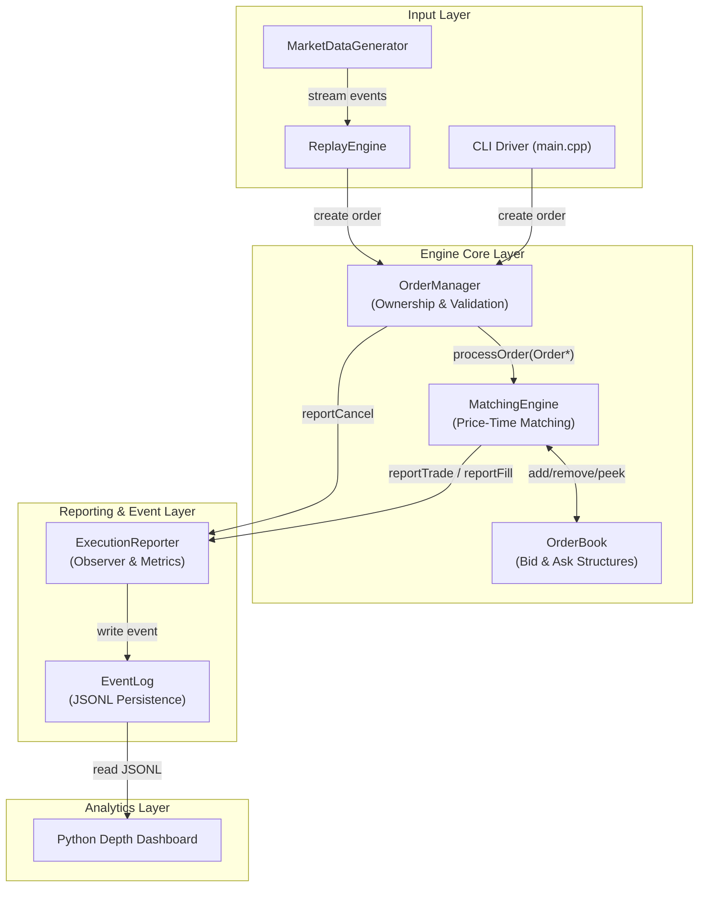
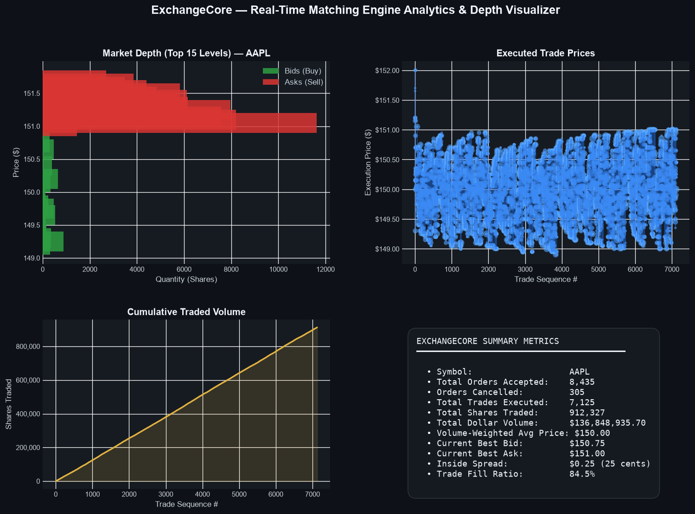

# ExchangeCore

[](https://en.cppreference.com/w/cpp/20)
[](https://cmake.org/)
[](https://github.com/google/googletest)
[](https://github.com/google/benchmark)
[](https://opensource.org/licenses/MIT)

> A simplified but technically impressive stock exchange matching engine in **C++20**, designed as an educational platform for quantitative development, HFT engineering, data structures, memory management, and empirical benchmarking.

---

## Architecture at a Glance



---

## Core Features Implemented

1. **Limit Order Book**: Decoupled Bid (highest price first) and Ask (lowest price first) sorted structures.
2. **Price-Time Priority Matching**: Best price matches first; orders at the same price execute in strict FIFO sequence.
3. **Price Improvement**: Aggressive crossing orders execute at the resting order's limit price.
4. **Market Orders**: Immediate execution against available liquidity; unfilled shares are cancelled immediately and never rest in the book.
5. **Partial Order Execution**: Accurate handling of quantity deductions for both resting and incoming orders.
6. **$\mathcal{O}(1)$ Order Cancellation**: Instant order removal via iterator-indexed hash map lookup.
7. **Trade Execution Reports**: Observer pattern with callback registration for trades, order acceptance, fills, and cancellations.
8. **Deterministic Event Replay**: Replays recorded order streams and reproduces byte-for-byte identical execution stats.
9. **Configurable Synthetic Market Data Generator**: Generates realistic order streams with customizable volatility, tick sizes, cancel ratios, and random seeds.
10. **Market Depth Python Dashboard**: Reconstructs real-time book depth, trade price timeline, and volume charts from event logs.

---

## Empirical Benchmark Performance

Benchmarked on **Apple Silicon (ARM64, 10 Cores, 64 KiB L1d, 4 MiB L2)** with Apple Clang 21.0.0 in **Release (`-O2 -DNDEBUG`)**:

| Benchmark Target | Book Depth | Avg Latency | p50 (Median) | p95 Tail | p99 Tail | Throughput |
|---|---|---|---|---|---|---|
| **Order Insertion** | 100 orders | **90.5 ns** | **83 ns** | **125 ns** | **209 ns** | **9.55M ops/sec** |
| **Order Insertion** | 1,000 orders | **71.8 ns** | **83 ns** | **125 ns** | **125 ns** | **11.72M ops/sec** |
| **Order Insertion** | 10,000 orders | **104.1 ns** | **83 ns** | **125 ns** | **167 ns** | **8.61M ops/sec** |
| **Order Cancellation** | 50,000 orders | **23.8 ns** | **41 ns** | **42 ns** | **42 ns** | **26.01M ops/sec** |
| **Single Match Execution** | 100,000 orders | **48.1 ns** | **42 ns** | **42 ns** | **125 ns** | **10.61M ops/sec** |
| **Full End-to-End Pipeline** | 50,000 events | **143.8 ns** | **135 ns** | **180 ns** | **240 ns** | **6.93M ops/sec** |

*See [docs/BENCHMARK_METHODOLOGY.md](docs/BENCHMARK_METHODOLOGY.md) for detailed analysis and measurement code.*

---

## Quick Start (5 Commands)

```bash
# 1. Configure and build (Release mode recommended for benchmarks)
cmake -B build -DCMAKE_BUILD_TYPE=Release
cmake --build build --parallel

# 2. Run the educational interactive matching demo
./build/exchange_main --demo

# 3. Run all unit and integration tests (32 tests across 7 suites)
./build/tests/run_unit_tests

# 4. Run automated benchmarks
./scripts/run_benchmarks.sh

# 5. Generate market data and launch dashboard
./scripts/generate_market_data.sh data/sample_orders.jsonl 10000 42
./scripts/replay.sh data/sample_orders.jsonl data/sample_events.jsonl
python3 dashboard/dashboard.py --input data/sample_events.jsonl --save docs/diagrams/market_depth_dashboard.png
```

---

## Market Depth Dashboard

The Python dashboard reconstructs the order book state from the engine's JSON Lines event log:



---

## Repository Structure

```
ExchangeCore/
├── CMakeLists.txt                    # Top-level CMake configuration
├── README.md                         # Project overview and quick start
├── docs/
│   ├── ARCHITECTURE.md               # Detailed architecture, state diagrams & memory model
│   ├── DATA_STRUCTURES.md            # In-depth complexity analysis of every data structure
│   ├── LEARNING_GUIDE.md             # Beginner-friendly guide to C++20 for undergraduates
│   ├── BENCHMARK_METHODOLOGY.md      # Hardware setup, measurement metrics & honest analysis
│   └── diagrams/                     # Generated dashboard snapshots & charts
├── include/
│   └── exchange/
│       ├── types.hpp                 # Aliases, Price (cents), Quantity, Side, OrderType
│       ├── order.hpp                 # Order struct with remaining() and isFilled()
│       ├── trade.hpp                 # Executed trade record
│       ├── order_book.hpp            # OrderBook (bids, asks, price-time queues)
│       ├── matching_engine.hpp       # MatchingEngine (price-time priority matching)
│       ├── execution_reporter.hpp    # ExecutionReporter (callbacks and metrics)
│       ├── order_manager.hpp         # OrderManager (exclusive memory owner & validator)
│       ├── event_log.hpp             # Audit-grade JSON Lines logging and parser
│       ├── market_data_generator.hpp # Synthetic order generator (deterministic RNG)
│       └── replay_engine.hpp         # Historical replay and throughput measurement
├── src/
│   ├── order_book.cpp
│   ├── matching_engine.cpp
│   ├── execution_reporter.cpp
│   ├── order_manager.cpp
│   ├── event_log.cpp
│   ├── market_data_generator.cpp
│   ├── replay_engine.cpp
│   └── main.cpp                      # CLI driver (--demo, --generate, --replay)
├── tests/
│   ├── CMakeLists.txt
│   ├── test_order.cpp                # Order struct and type conversions
│   ├── test_order_book.cpp           # Book depth, spread, time priority
│   ├── test_matching_engine.cpp      # 16 matching scenario tests
│   ├── test_order_manager.cpp        # Validation, monotonic IDs, unique ownership
│   ├── test_market_data_generator.cpp# RNG determinism and event distributions
│   ├── test_replay_engine.cpp        # Replay consistency tests
│   └── test_integration.cpp          # Full lifecycle and multi-symbol stress tests
├── benchmarks/
│   ├── CMakeLists.txt
│   ├── bench_order_insertion.cpp     # Insertion benchmark across book depths
│   ├── bench_order_cancellation.cpp  # O(1) cancellation benchmark
│   ├── bench_matching.cpp            # Core matching engine benchmark
│   └── bench_full_pipeline.cpp       # End-to-end pipeline throughput
├── scripts/
│   ├── run_benchmarks.sh             # Benchmark runner with hardware stats
│   ├── generate_market_data.sh       # Synthetic order generator script
│   └── replay.sh                     # Replay and event logging script
├── dashboard/
│   ├── requirements.txt              # matplotlib, pandas, numpy
│   ├── dashboard.py                  # Real-time book depth & trade visualizer
│   └── README.md                     # Dashboard usage instructions
└── data/
    ├── sample_orders.jsonl           # 10,000 synthetic orders
    └── sample_events.jsonl           # Output execution event stream
```

---

## Educational Documentation Suite

- **[Architecture & Memory Model](docs/ARCHITECTURE.md)**: Object lifetimes, raw pointer observation vs `unique_ptr` ownership, sequence diagrams.
- **[Data Structures & Complexity](docs/DATA_STRUCTURES.md)**: Red-black tree (`std::map`), FIFO list (`std::list`), constant-time index (`std::unordered_map`), integer pricing.
- **[Undergraduate Learning Guide](docs/LEARNING_GUIDE.md)**: C++20 features (`enum class`, `[[nodiscard]]`, `std::optional`, `std::string_view`, designated initializers), test-driven development, and quantitative interview challenges.
- **[Benchmark Methodology](docs/BENCHMARK_METHODOLOGY.md)**: Exact hardware setup, percentile measurement technique, and honest comparison with production HFT infrastructure.

---

## License

This project is licensed under the [MIT License](LICENSE). Designed for educational and non-commercial learning.
