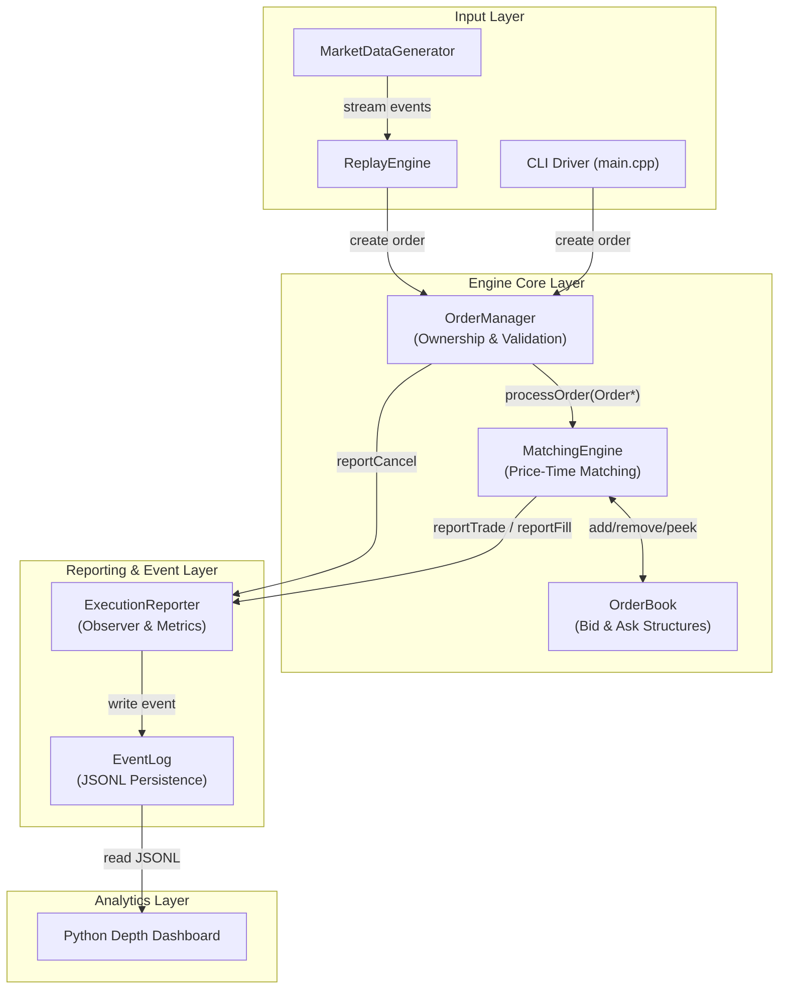
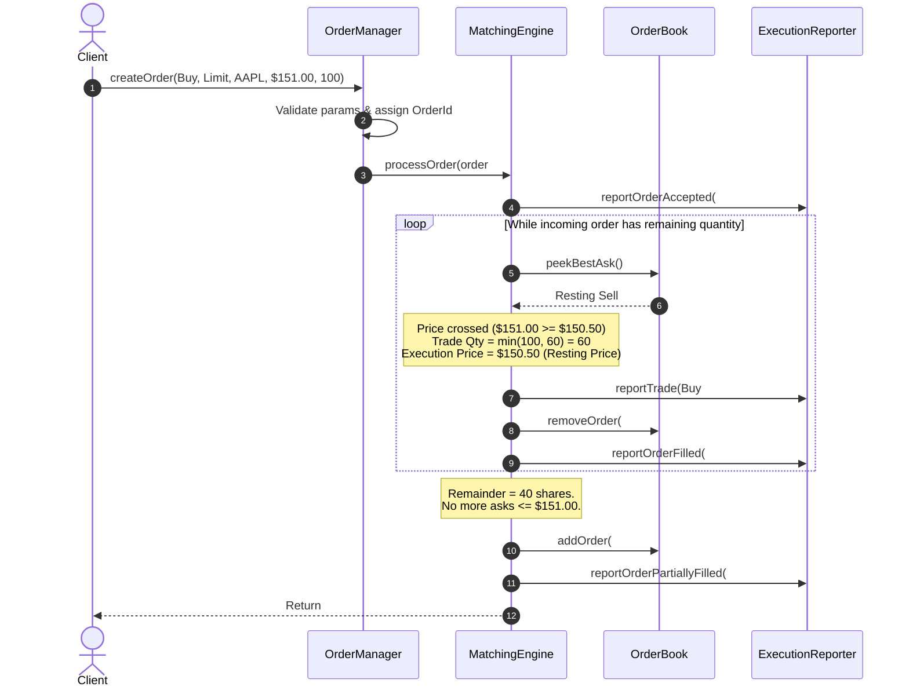

# ExchangeCore — Architecture & System Design

ExchangeCore is an educational, high-throughput stock exchange matching engine written in modern C++20. This document details its architectural boundaries, data flow, component responsibilities, and memory management model.

---

## 1. System Architecture Overview

ExchangeCore is decomposed into four decoupled layers:



---

## 2. Component Breakdown

### 2.1 OrderManager (`order_manager.hpp / .cpp`)
- **Single Source of Truth**: Sole owner of all order instances via `std::unordered_map<OrderId, std::unique_ptr<Order>>`.
- **Validation**:
  - Enforces non-empty ticker symbols.
  - Enforces positive share quantities (`quantity > 0`).
  - Enforces positive price for `Limit` orders (`price > 0`).
  - Allows zero price for `Market` orders.
- **ID Generation**: Assigns monotonic 64-bit integer IDs (`1, 2, 3...`) or supports custom deterministic IDs during stream replay.
- **Pointer Stability**: Orders reside inside `std::unique_ptr<Order>` nodes, ensuring that pointer addresses passed to the order book remain stable across rehashes.

### 2.2 OrderBook (`order_book.hpp / .cpp`)
- **Side Separation**:
  - **Bids (Buy)**: Sorted in descending order using `std::map<Price, std::list<Order*>, std::greater<Price>>`. Highest price at `begin()`.
  - **Asks (Sell)**: Sorted in ascending order using `std::map<Price, std::list<Order*>, std::less<Price>>`. Lowest price at `begin()`.
- **Time Priority Queue**:
  - Each price level contains an `std::list<Order*>`.
  - New orders append to the back (`push_back`).
  - Counterparty matches consume from the front (`peekBestBid()->pop_front()`).
- **O(1) Order Cancellation Index**:
  - Maintains `std::unordered_map<OrderId, OrderLocation>` storing `{Side, Price, list::iterator}`.
  - Allows immediate erasure without linear scanning through price levels.

### 2.3 MatchingEngine (`matching_engine.hpp / .cpp`)
- **Price-Time Priority Matching**:
  - Evaluates crossing conditions: `incoming_buy.price >= best_ask.price` or `incoming_sell.price <= best_bid.price`.
  - **Price Improvement**: Trades execute at the resting order's limit price.
  - **Partial Fills**: Tracks `filled_quantity` and updates status to `PartiallyFilled` or `Filled`.
  - **Market Orders**: Match greedily against available book depth; unexecuted shares are cancelled immediately and never enter the book.
  - **Multi-Symbol Routing**: Automatically isolates order books by ticker symbol (`std::unordered_map<std::string, std::unique_ptr<OrderBook>>`).

### 2.4 ExecutionReporter & EventLog (`execution_reporter.hpp`, `event_log.hpp`)
- **Observer Pattern**: Decouples matching logic from logging, UI, and external consumers via function callbacks (`onTrade`, `onOrderAccepted`, `onOrderCancelled`).
- **Audit-Grade Event Log**: Streams machine-readable JSON Lines records to disk for auditability and post-trade analysis.

---

## 3. Order Lifecycle State Machine

```mermaid
stateDiagram-v2
    [*] --> New: OrderManager::createOrder()
    New --> Rejected: Validation Failed (Price <= 0 or Qty == 0)
    New --> Filled: Immediate Full Execution
    New --> PartiallyFilled: Partial Execution Against Book
    New --> RestingInBook: Limit Order (Spread not crossed)
    
    RestingInBook --> PartiallyFilled: Counterparty Order Matches Partial Qty
    RestingInBook --> Filled: Counterparty Order Matches Remaining Qty
    RestingInBook --> Cancelled: Client Cancellation Request
    
    PartiallyFilled --> Filled: Subsequent Counterparty Match
    PartiallyFilled --> Cancelled: Client Cancels Remainder / Market Order Expires
    
    Filled --> [*]
    Cancelled --> [*]
    Rejected --> [*]
```

---

## 4. Sequence of an Aggressive Match



---

## 5. Memory Management & Ownership Model

In low-latency systems, unclear object ownership leads to dangling pointers, cache thrashing, or double-free vulnerabilities. ExchangeCore implements strict ownership rules:

```
┌──────────────────────────────────────────────────────────────┐
│ OrderManager (Exclusive Owner)                               │
│  std::unordered_map<OrderId, std::unique_ptr<Order>>         │
│     │                                                        │
│     ├─── Order #1 (Heap Node) <───────┐                      │
│     ├─── Order #2 (Heap Node) <───┐   │                      │
│     └─── Order #3 (Heap Node)     │   │                      │
└───────────────────────────────────┼───┼──────────────────────┘
                                    │   │
┌───────────────────────────────────┼───┼──────────────────────┐
│ OrderBook (Non-owning Observer)   │   │                      │
│  bids_ / asks_:                   │   │                      │
│    PriceLevel $150.00 ──> [ Order* #1 ]                      │
│    PriceLevel $151.00 ──> [ Order* #2 ]                      │
│                                                              │
│  order_locations_:                                           │
│    OrderId 1 ──> {Side::Buy,  15000, iterator_to_#1}         │
│    OrderId 2 ──> {Side::Sell, 15100, iterator_to_#2}         │
└──────────────────────────────────────────────────────────────┘
```

1. **Allocations happen only once** when `createOrder` is called.
2. The `OrderBook` and `MatchingEngine` work strictly with non-owning raw pointers (`Order*`).
3. Because orders are stored in `std::unique_ptr<Order>`, their addresses never change even if the hash map rehashes.
4. When an order completes or is cancelled, it is unlinked from the book structures in O(1) time without deallocating until the session clears.

---

## 6. Concurrency Strategy

ExchangeCore strictly adopts a **single-threaded core matching engine** design:

1. **Why Single-Threaded Core?**
   - In production exchanges (such as LMAX Disruptor, NASDAQ INET, CME Globex), core matching is fundamentally single-threaded or pinned to a dedicated CPU core.
   - Mutex locks and atomic synchronizations across multiple threads introduce context switching, cache line bouncing, and non-deterministic jitter that degrade tail latency (p99).
2. **Deterministic Execution**:
   - Given an identical stream of input orders, the engine produces an identical, byte-for-byte stream of trade events every time.
3. **Optional Asynchronous Boundary**:
   - I/O logging (writing JSONL to NVMe) and dashboard metrics are handled out-of-band via observer callbacks or non-blocking event queues, isolating matching latency from file system I/O.
