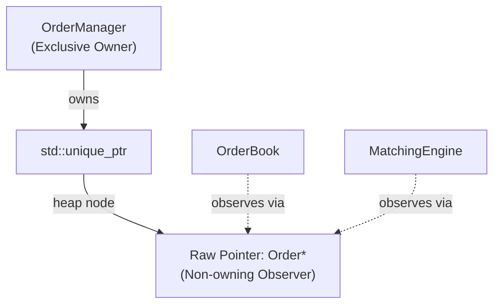

# ExchangeCore — C++20 & Quantitative Systems Learning Guide

> **Audience**: Second-year Computer Science / Software Engineering undergraduates and aspiring quantitative developers.

Welcome to **ExchangeCore**! This guide bridges the gap between introductory CS coursework and professional C++ systems programming. It explains the exact language mechanisms, design choices, and best practices used throughout the engine.

---

## 1. Modern C++20 Features Explained

### 1.1 Strongly-Typed Scoped Enums (`enum class`)
In older C++, plain `enum` polluted the global namespace and implicitly converted to integers:

```cpp
// OLD C-STYLE ENUM (Error-prone)
enum Side { Buy, Sell };
int x = Buy; // Implicitly converts to 0!
if (x == 0) { ... } // Dangerous: mixes apples with integers
```

In ExchangeCore, we use `enum class`:
```cpp
enum class Side : std::uint8_t {
    Buy,
    Sell
};

// COMPILER ENFORCES SAFETY:
Side s = Side::Buy;
// int i = s;           // COMPILE ERROR! No implicit conversion
// if (s == 0)          // COMPILE ERROR!
```
- **Type Safety**: Prevents comparing an `OrderStatus` to a `Side`.
- **Memory Footprint**: `: std::uint8_t` ensures each enum instance takes only **1 byte** of memory instead of 4 or 8 bytes.

---

### 1.2 `[[nodiscard]]` (Attribute)
Annotating a function with `[[nodiscard]]` instructs the compiler to issue a warning if the caller ignores the return value:

```cpp
[[nodiscard]] Quantity remaining() const noexcept {
    return quantity - filled_quantity;
}

[[nodiscard]] std::optional<Price> bestBid() const;
```
If someone writes `book.bestBid();` without storing or checking the result, the compiler immediately catches the bug.

---

### 1.3 `std::optional<T>`
How do you represent a value that might not exist? (e.g. asking for the best bid when the order book is empty).

- **Bad Old Way**: Return a magic number like `-1` or `0` or `nullptr`.
- **Modern C++ Way**: `std::optional<T>`:

```cpp
std::optional<Price> bb = book.bestBid();

if (bb.has_value()) {
    std::cout << "Best bid is: " << *bb << "\n";
} else {
    std::cout << "Order book is empty!\n";
}
```
`std::optional` is stored directly on the stack (no heap allocation) and makes "absence of value" explicit in the API.

---

### 1.4 `std::string_view` (Zero-Copy String References)
Passing `const std::string&` requires an existing heap-allocated string object. Passing `std::string_view` takes only a pointer and a length (16 bytes on 64-bit systems):

```cpp
void processOrder(std::string_view symbol);
```
You can pass a string literal (`"AAPL"`), a `std::string`, or a substring without any dynamic memory allocations.

---

### 1.5 C++20 Designated Initializers
ExchangeCore uses C++20 designated initializers for clear, self-documenting struct creation:

```cpp
Order order{
    .id = 101,
    .symbol = "AAPL",
    .side = Side::Buy,
    .type = OrderType::Limit,
    .price = 15000,
    .quantity = 100
};
```
No guessing which argument is `price` and which is `quantity` in a long constructor parameter list.

---

## 2. Memory Management: Ownership vs Observation

One of the most critical concepts in C++ is **object lifetime and ownership semantics**.



### The Rule of Ownership in ExchangeCore
1. **Who owns the order?**
   `OrderManager` owns every order exclusively using `std::unique_ptr<Order>`.
2. **Who observes the order?**
   `OrderBook` and `MatchingEngine` use raw non-owning pointers (`Order*`).
3. **Why not `std::shared_ptr`?**
   `std::shared_ptr` uses an atomic control block with atomic reference counting. In tight trading loops processing millions of operations per second, atomic increments (`lock xadd`) pollute the CPU cache and slow down throughput significantly.
4. **Pointer Stability**:
   Because `std::unique_ptr<Order>` allocates each order node separately on the heap, the memory address of an `Order` stays valid until `OrderManager` explicitly deletes it.

---

## 3. How CMake Organizes a Modern C++ Project

`CMake` generates native build files (Makefiles or Ninja) for any compiler or operating system:

```
CMakeLists.txt                <-- Configures global standards, dependencies (GTest, Benchmark)
├── src/                      <-- Compiles libexchange_core and exchange_main
├── tests/CMakeLists.txt      <-- Configures GoogleTest test runner (run_unit_tests)
└── benchmarks/CMakeLists.txt <-- Configures Google Benchmark binaries
```

### Key CMake Commands to Understand:
- `add_library(exchange_core ...)`: Compiles your engine code into a reusable static library.
- `target_include_directories(exchange_core PUBLIC include)`: Tells anyone linking against `exchange_core` where to find its header files (`#include "exchange/..."`).
- `target_link_libraries(exchange_main PRIVATE exchange_core)`: Links the library into the executable.

---

## 4. GoogleTest Best Practices

ExchangeCore organizes tests with the **Arrange-Act-Assert** pattern:

```cpp
TEST_F(MatchingEngineTest, Scenario1_ExactMatch) {
    // 1. Arrange: Setup the initial order book state
    auto* sell = order_mgr.createOrder(Side::Sell, OrderType::Limit, "AAPL", 5000, 100);
    engine.processOrder(sell);

    // 2. Act: Submit a matching counterparty order
    auto* buy = order_mgr.createOrder(Side::Buy, OrderType::Limit, "AAPL", 5000, 100);
    engine.processOrder(buy);

    // 3. Assert: Verify post-conditions
    ASSERT_EQ(trades.size(), 1);            // Fatal if trade wasn't generated
    EXPECT_EQ(trades[0].quantity, 100);     // Non-fatal inspection
    EXPECT_EQ(buy->status, OrderStatus::Filled);
}
```

- **`ASSERT_*`**: Aborts the current test immediately if false (useful for checking pointers before dereferencing).
- **`EXPECT_*`**: Continues running the rest of the test so you can see all failing assertions at once.

---

## 5. Recommended Learning Challenges for Students

To deepen your understanding of quantitative development, try implementing these extensions:

1. **Stop-Loss / Stop-Limit Orders**:
   - Add an order type that stays dormant until the market trade price reaches a `trigger_price`, then activates into a standard Market or Limit order.
2. **Iceberg Orders**:
   - Create an order with a large total quantity but only reveals a small `peak_quantity` in the visible market depth book.
3. **Fill-or-Kill (FOK) and Immediate-or-Cancel (IOC)**:
   - Add time-in-force flags. If an FOK order cannot be 100% matched immediately upon arrival, reject the entire order with zero partial fills.
4. **Custom Fixed-Block Object Pool**:
   - Implement a simple memory pool (pre-allocated array) for `Order` structs to replace heap allocations and benchmark the latency difference!
